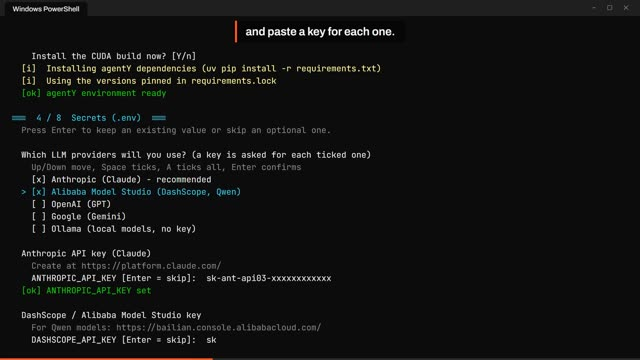
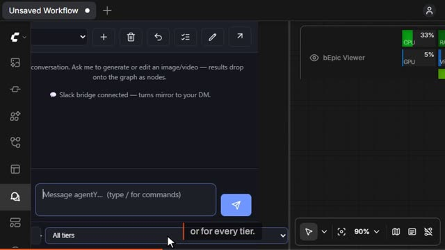
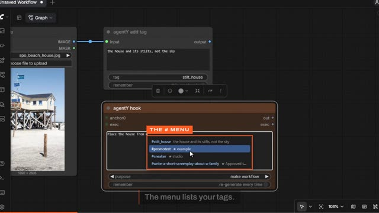
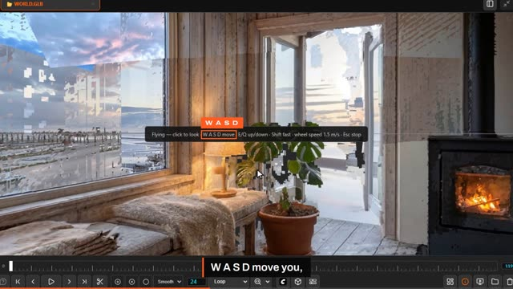
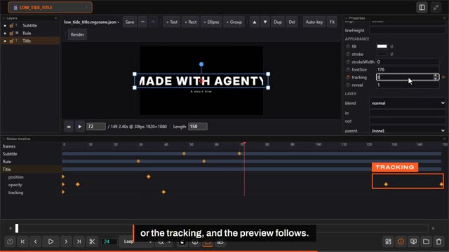
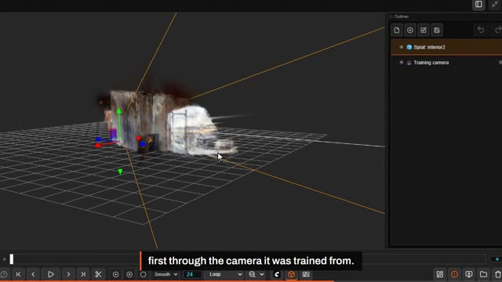
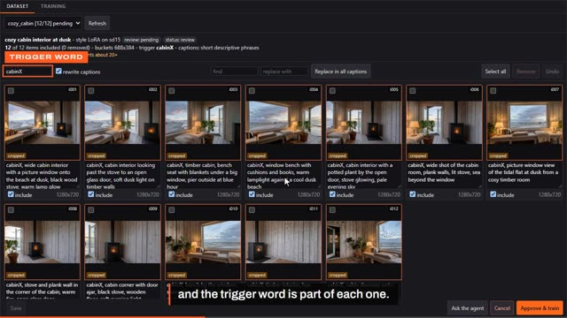

# Video tutorials

Seven short videos (about a minute each) that show agentY's main features on screen.
Click a picture to play the video. For the full written guide see [Using agentY](using-agentY.md).

| | |
|---|---|
|  | **1 · Install** (1:00) Clone the `stable` branch, run the installer, pick LLM providers, the execution mode and MCP presets, start agentY, and find the agentY tab in ComfyUI's sidebar. See also [Installation](../README.md#installation). |
|  | **2 · The chat panel and Settings** (1:22) Conversations, undo, the prompt loop, `/` commands, attaching images, choosing the model per role or tier, agentY hooks (full run and dry run), then Settings: models, MCP servers from presets, execution mode, Slack and pricing. See also [The chat panel](using-agentY.md#the-chat-panel) and [Settings & secrets](using-agentY.md#settings--secrets). |
|  | **3 · Tags, hooks, loops and reviews** (1:19) Tag a reference with `agentY add tag` or from the viewer, use it with `#` in a hook prompt, chain hook stages on the execution wire, repeat stages in a loop until a condition holds, and pick what continues at a review stop in the bEpic viewer. See also [The hook system](using-agentY.md#the-hook-system). |
|  | **4 · World Labs Atlas** (0:59) Ask agentY for a world from one picture, orbit and fly through it in the viewer (Shift+J, W A S D), paint the view you are looking through with **Render with Atlas** and add it to the world, and keyframe a camera move through it. See also [worldlabs_atlas.md](integrations/worldlabs_atlas.md). |
|  | **5 · Motion graphics** (1:25) Ask agentY for a title card, then edit it in the viewer's Motion tab: layers, keyframes, curves, on-canvas move / scale / rotate / anchor, text. Save, Render, and reopen it from its poster PNG with **Edit in Motion**. |
|  | **6 · Gaussian splats** (0:54) Ask agentY to train a splat from an Atlas world (locally with Brush, no credits), step through the training previews, open and orbit the splat in the viewer, render a camera move through it, and use the standard `.ply` elsewhere. |
|  | **7 · LoRA training** (0:55) Ask agentY to prepare a dataset, review and edit it in the viewer's Dataset panel (captions, include / exclude), press **Approve & train**, watch steps, loss and samples in the Training tab, and find the LoRA in `loras/agentY/`. |
